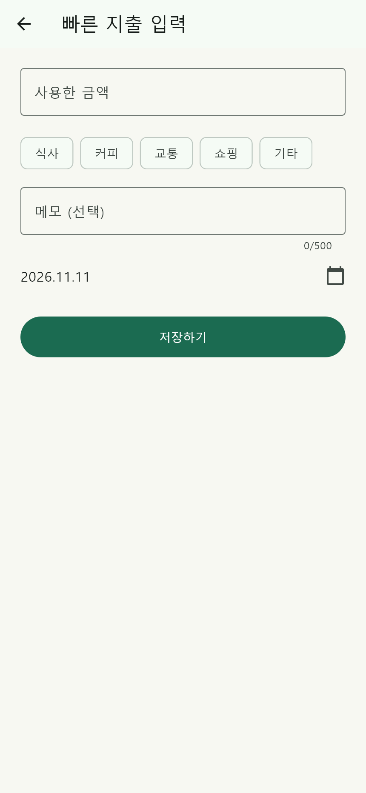
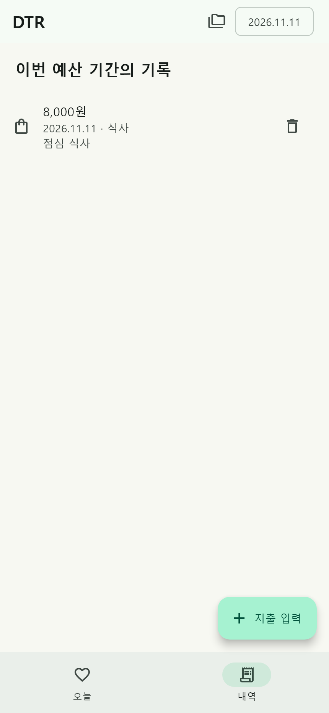

# 돈토리 · DTR

**소비하기 전에 오늘 남은 예산을 확인하는 Android 생활비 앱**

다음 수입일까지 쓸 수 있는 돈을 하루 예산으로 나누고, 돈토리 캐릭터와 생활비 HP로 보여줍니다. 홈 화면 위젯에서 예산을 확인하고, 구매가 고민될 때 돈토리와 대화하며 충동소비를 한 번 더 돌아보도록 돕습니다.

[개발 환경](docs/DEVELOPMENT.md) · [Claude 서버 설정](docs/CHAT_SETUP.md) · [베타 사용 분석](docs/BETA_MEASUREMENT.md) · [실기기 점검](docs/DEVICE_CHECK.md)

## 주요 기능

| 기능 | 설명 |
| --- | --- |
| 오늘 예산 · 생활비 HP | 보호할 저축과 미결제 고정지출을 제외한 생활비를 날짜별로 배분합니다. 지출과 날짜 변경에 맞춰 남은 예산을 계산합니다. |
| 지출 기록 | 금액만으로 빠르게 저장하고, 분류·메모를 추가하거나 내역을 수정·삭제할 수 있습니다. |
| 돈토리 성장 | 기록과 절약으로 얻은 도토리 5개로 한 레벨 성장합니다. Lv.5에 단풍 왕관을 얻고 이후에도 강화할 수 있습니다. |
| 예산 조정 | 추가 수입과 저축 목표 변경을 반영하고 변경 이력을 보관합니다. |
| 돈토리 홈 위젯 | 숲 배경과 캐릭터, 남은 예산, HP를 표시합니다. 돈토리를 누르면 대화, 지출 입력 버튼을 누르면 입력 화면으로 이동합니다. |
| 돈토리와 대화 | 기본 대화와 구매 전 예산 계산은 기기에서 실행합니다. Claude 상담은 서버 연결·초대 코드·전송 동의 후 이용합니다. |
| 백업 · 복원 | 기기 안의 SQLite에 기록을 저장하고 Android 파일 선택기로 JSON 백업을 내보내거나 복원합니다. |
| 베타 사용 분석 | 선택 동의한 설치의 D1·D7 재방문율, 주간 기록일 수, 위젯 진입률을 관리자 대시보드에서 확인합니다. |

현재 베타는 지출을 직접 입력하는 방식입니다. 은행·카드 자동 연동과 매월 예산 자동 갱신은 지원하지 않습니다.

## 기본 화면

| 예산 설정 | 오늘 예산 | 지출 입력 | 지출 내역 |
| :---: | :---: | :---: | :---: |
|  |  |  |  |

기본 사용 흐름을 보여주는 예시 데이터 화면입니다. 최신 위젯·대화·분석 화면은 포함하지 않으며, 베타 버전과 기기에 따라 배치가 다를 수 있습니다.

## 빠른 시작

### 개발 환경

| 항목 | 기준 |
| --- | --- |
| Flutter / Dart | Flutter 3.47.9 stable · Dart 3.13.7 |
| Android 도구 | JDK 21 · SDK Platform 36 · Build Tools 36.0.0 · NDK 28.2.13676358 |
| 실행 대상 | Android 7.0(API 24) 이상 |
| 서버 개발 | Node.js 22 이상, SQLite 테스트는 Node.js 24 권장 |

```sh
git clone https://github.com/imjunseoo/DTR.git
cd DTR
flutter pub get
flutter devices
flutter run -d DEVICE_ID
```

`DEVICE_ID`는 연결된 Android 실기기나 에뮬레이터 ID로 바꿉니다. Windows에서는 `flutter` 대신 저장소의 `.\flutter.ps1`을 사용할 수 있습니다. 도구 설치는 [개발 환경 안내](docs/DEVELOPMENT.md)를 참고하세요.

설치 후 Android 홈 화면의 위젯 목록에서 돈토리를 추가합니다. QA 모드는 앱 제목을 길게 눌러 진입합니다.

### 기본 APK 빌드

```sh
flutter build apk --debug
```

결과: `build/app/outputs/flutter-apk/app-debug.apk`

기본 빌드는 로컬 예산·기본 대화를 사용할 수 있으며, Claude와 원격 사용 분석은 연결하지 않습니다. APK와 서명 키는 Git에 포함하지 않습니다.

### 서버 연결 베타 빌드

Cloudflare 서버와 비밀값을 먼저 설정한 뒤, 아래 주소를 본인의 서버 주소로 바꿔 실행합니다.

```sh
flutter build apk --debug --build-number=3 --build-name=1.0.0-beta.3 --dart-define=DTR_CHAT_URL=https://YOUR_HOST/chat --dart-define=DTR_ANALYTICS_URL=https://YOUR_HOST --dart-define=DTR_APP_VERSION=1.0.0-beta.3+3
```

- **Claude 대화:** [서버 설정과 초대 코드 발급](docs/CHAT_SETUP.md)
- **사용 분석:** [동의 절차·집계 기준·관리자 접속](docs/BETA_MEASUREMENT.md)
- **디자인 명세:** [Figma 대화 화면](https://www.figma.com/design/SMigmzPpEFzOww1QPpbudr?node-id=70-29) · [Figma 베타 분석](https://www.figma.com/design/SMigmzPpEFzOww1QPpbudr?node-id=72-34)

API 키·관리자 접근 키·초대 코드는 APK 빌드 인자나 Git에 넣지 않습니다. 서버의 비밀값 저장소에서 관리합니다.

## 베타 데이터 확인

테스터는 **홈 하단 → 베타 테스트 참여 · 사용 데이터 설정 → 초대 코드 입력 → 선택 동의**로 참여합니다. 동의하지 않아도 기본 앱 기능을 이용할 수 있습니다.

| 지표 | 집계 기준 |
| --- | --- |
| D1 · D7 재방문율 | 동의 후 처음 예산이 준비된 날을 D0로 삼아, 정확히 1일·7일 뒤 활동한 설치 비율 |
| 주간 기록일 수 | 월~일 지출을 새로 저장한 날짜 수의 설치당 평균. 같은 날 여러 건은 1일, 기록이 없는 설치는 0일 |
| 위젯 진입률 | 위젯 클릭이 있었던 세션 ÷ 전체 세션. 위젯을 보기만 한 사용은 측정하지 않음 |

한국 날짜와 설치 단위로 집계합니다. D1·D7의 관측 날짜가 아직 끝나지 않았으면 ‘관측 대기’로 표시합니다. 동의 이전 기록을 소급 수집하지 않으며 QA 모드는 제외합니다.

## 데이터 보관

- 예산과 지출 내역은 기기에 저장합니다. JSON 백업은 평문이며, 복원하면 기존 예산과 지출을 교체합니다.
- Claude에는 전송 동의 후 예산 요약과 최근 AI 대화를 보냅니다. 전체 지출 내역과 메모를 자동 전송하지 않습니다.
- 사용 분석에는 무작위 설치 ID와 사용 이벤트를 보내며 소비 금액·분류·메모·대화 내용은 포함하지 않습니다.
- 분석 이벤트는 90일 후 삭제합니다. 앱 설정에서 수집을 중지하고 서버 데이터 삭제를 요청할 수 있습니다. 오프라인 요청은 연결 후 재시도합니다.

## 검사

```sh
flutter analyze
flutter test
node --test server/chat-server.test.mjs server/cloudflare/worker.test.mjs server/cloudflare/analytics.test.mjs
```

예산 계산·저장·백업·대화·동의 및 오프라인 처리를 앱 테스트로, 인증·집계·중복 제거·삭제를 서버 테스트로 확인합니다. Android 런처 위젯과 파일 선택기는 [실기기 체크리스트](docs/DEVICE_CHECK.md)로 별도 점검합니다.

Drift 테이블 정의를 변경했다면 생성 코드도 함께 갱신합니다.

```sh
dart run build_runner build
```

## 저장소 구성

```text
lib/
  domain/             예산 계산 · 대화 규칙 · 백업 검증
  data/               SQLite 저장 · Claude 연결 · 사용 분석
  ui/                 Flutter 화면 · Riverpod 상태
  platform/           Android 연결
android/app/src/main/ Kotlin 위젯 · 앱 진입 · 파일 선택기
server/
  chat-server.mjs     로컬 Node.js 대화 서버
  cloudflare/         HTTPS API · 분석 저장소 · 관리자 대시보드
test/                 앱 테스트
docs/                 개발 · 배포 · 운영 안내
```

세부 구현과 이전 개발 경과는 [구현 문서](docs/IMPLEMENTATION.md)와 [개발 인계 문서](docs/HANDOFF.md)를 참고하세요.
