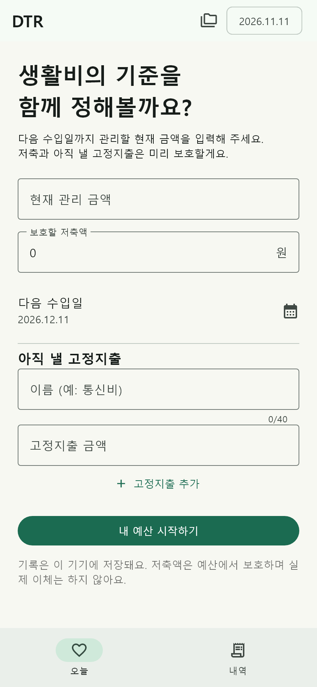
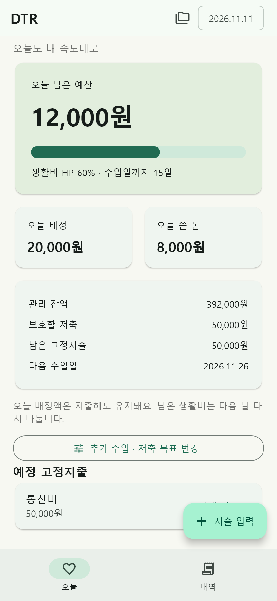

# DTR (돈토리)

DTR은 다음 수입일까지 **오늘 얼마를 쓸 수 있는지** 보여주는 Android 생활비 앱입니다. 현재 관리할 금액에서 보호할 저축과 아직 낼 고정지출을 먼저 떼어 두고, 남은 생활비를 날짜별로 나눕니다. 예를 들어 15일 동안 쓸 생활비가 30만 원이면 오늘 배정액은 2만 원입니다. 식사에 8천 원을 쓰면 오늘 남은 예산은 1만 2천 원, 생활비 HP는 60%가 됩니다.

## 화면

| 첫 예산 설정 | 오늘 예산 | 빠른 지출 입력 | 지출 내역 |
| --- | --- | --- | --- |
|  |  |  |  |

현재 앱 화면을 예시 데이터로 렌더링한 이미지입니다. 기기의 글꼴과 화면 크기에 따라 배치가 달라질 수 있습니다.

## 주요 기능

- **하루 예산** · 수입일 전날까지 남은 일수로 생활비를 배분합니다. 지출을 입력하면 오늘 잔여액과 HP가 줄고, 다음 날에는 남은 생활비로 하루 배정액을 다시 계산합니다. 예산을 초과해도 지출을 기록할 수 있습니다.
- **지출 기록** · 금액만 입력해 저장할 수 있고, 분류와 메모를 덧붙일 수 있습니다. 현재 예산 기간의 지출을 수정·삭제하거나 삭제 직후 실행을 취소할 수 있습니다. 고정지출은 결제 시 예약액도 함께 해제합니다.
- **예산 조정** · 추가 수입과 저축 목표 변경을 오늘부터 반영하고 변경 이력을 보관합니다.
- **홈 화면 위젯** · 기준일, 남은 예산, HP를 표시합니다. 위젯의 ‘지출 입력’을 누르면 앱의 입력 화면이 열립니다. 날짜가 지난 위젯은 앱에서 오늘 예산을 확인하도록 안내합니다.
- **기기 저장과 백업** · 기록은 기기 안의 SQLite에 저장됩니다. Android 파일 선택기로 JSON 백업을 내보내고 복원할 수 있습니다. 백업은 평문 파일이며, 복원을 확인하면 기기의 예산과 지출 전체를 선택한 백업으로 교체합니다.

현재 MVP에서는 사용자가 지출을 직접 기록하고 수입일에 다음 예산을 설정합니다. 은행·카드 연동, 매월 자동 반복, 식사·커피 단위 환산은 구현 전입니다. 실제 휴대폰에서 확인할 위젯·파일 선택·날짜 전환 항목은 [실기기 테스트 안내](docs/DEVICE_CHECK.md)를 참고하세요.

## 다른 PC에서 실행

GitHub의 비공개 DTR 저장소에 접근할 수 있는 계정으로 로그인한 뒤, **Code → HTTPS**에서 복제 주소를 복사합니다. `git clone <복사한-주소> DTR` 후 `cd DTR`로 이동하세요. 이미 복제한 PC에서는 작업을 시작하기 전에 `git pull --ff-only`로 최신 코드를 받습니다.

이 저장소에는 앱 소스와 예시 화면이 들어 있습니다. 실제 지출 기록은 휴대폰의 JSON 백업으로 별도 이전합니다. APK, 개발 도구, 서명 키는 저장소에 포함하지 않습니다. [Windows 개발 환경 준비](docs/DEVELOPMENT.md)를 참고하세요.

프로젝트 루트는 이 README와 `pubspec.yaml`이 있는 폴더입니다. 아래 명령은 이 폴더에서 실행합니다.

| 항목 | 개발 환경 |
| --- | --- |
| Flutter / Dart | Flutter 3.47.9 stable · Dart 3.13.7 |
| Android 빌드 | JDK 21 · Android SDK Platform 36 · Build Tools 36.0.0 · NDK 28.2.13676358 |
| 실행 대상 | Android 7.0(API 24) 이상 실기기 또는 Android 가상 기기 |

1. Flutter SDK와 Android 개발 도구를 설치하고 `flutter` 명령을 사용할 수 있게 합니다. `flutter doctor -v`로 Android 도구 상태를 확인합니다. Android SDK 라이선스가 필요하면 `flutter doctor --android-licenses`를 실행해 약관을 확인합니다.
2. USB 디버깅을 활성화한 Android 기기를 연결하거나 Android 가상 기기를 실행합니다.
3. 프로젝트 루트에서 패키지를 받고 기기 목록을 확인합니다.

   ```sh
   flutter pub get
   flutter devices
   ```

4. 목록에서 확인한 Android 기기 ID를 `DEVICE_ID` 자리에 넣어 실행합니다.

   ```sh
   flutter run -d DEVICE_ID
   ```

홈 화면 위젯은 앱을 설치한 뒤 Android 홈 화면의 위젯 목록에서 추가합니다.

## 검사와 빌드

```sh
flutter analyze
flutter test
flutter build apk --debug
```

개발용 설치 파일은 `build/app/outputs/flutter-apk/app-debug.apk`에 생성됩니다. 테스트에서는 날짜별 배분과 고정지출 처리, SQLite 저장·재개, 백업 검증·복원, 지출 입력 후 예산 화면 갱신을 확인합니다.

Drift 데이터베이스의 생성 코드는 `lib/data/database.g.dart`에 포함됩니다. 테이블 정의를 변경했다면 아래 명령을 실행하고 생성 코드도 함께 반영합니다.

```sh
dart run build_runner build
```

## 소스 구성

- `lib/domain/` — 날짜별 예산 계산과 백업 데이터 검증
- `lib/data/` — Drift 테이블, 지출 저장, 날짜별 배정 기록
- `lib/ui/` — Flutter 화면과 Riverpod 상태 관리
- `lib/platform/` — Flutter와 Android 사이의 호출
- `android/app/src/main/` — Kotlin 홈 위젯과 Android 파일 선택기
- `test/` — 계산·저장·백업·화면 테스트
